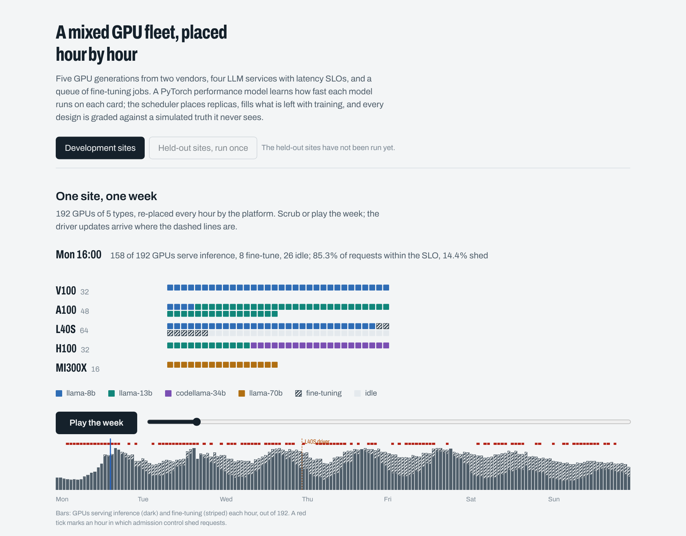

# mixed-fleet-scheduler

A scheduler and a calibrated simulator for GPU fleets that mix generations and vendors (V100, A100, L40S, H100,
MI300X, B200). A PyTorch performance model learns how fast each LLM runs on each GPU type at each batch size and
tensor-parallel degree from a few hundred profiles; the scheduler places inference replicas against latency SLOs,
fills the idle GPUs with fine-tuning jobs, falls back to a heuristic where the model is unsure, and learns from what
the running replicas measure. Every policy is benchmarked on the same simulated traces, and the same model answers
"what does buying 32 more cards give us?".



## Why

Most schedulers assume a GPU is a GPU. In a fleet that grew over five years, a decode step of the same model can
take three times longer on one card than on another, a 70B model does not fit on half the cards at all, and a
driver update can make one card type 20% slower overnight. A scheduler that does not know this either breaks SLOs
or leaves GPUs idle. The data sheet alone (a roofline) is wrong by about 15%, and by much more on some model-on-GPU
pairs. This repository shows what a learned performance model with guardrails buys on top, measured against a truth
the designs never see.

## What the role asks for, and where it is

| The role asks for | Where it is in this repository |
|---|---|
| ML models of GPU workload performance | `src/mfs/platform/perfmodel.py`: PyTorch ensemble predicting decode-step time and its spread per model, GPU, batch and tensor-parallel degree; split-conformal calibration of the spread (ADR 0002) |
| Scheduling for inference, training and evaluation across heterogeneous GPUs | `src/mfs/platform/scheduler.py`: replica placement under TPOT and TTFT SLOs, memory fit, routing, admission control; fine-tuning jobs backfill idle GPUs with preemption (ADR 0004) |
| Simulation of datacenter behaviour | `src/mfs/world/world.py`: a roofline truth with hidden efficiencies, link costs, memory limits, driver changes, diurnal and bursty traffic; `sim/evaluate.py` grades every hour |
| Answering capacity questions | `expansion_forecast` in `sim/evaluate.py`: the twin's forecast of a GPU purchase against the site's truth |
| Profiling real hardware | `src/mfs/profiling/host.py`: torch.profiler on decode-like kernels, labelled measured |
| Production engineering | stdlib HTTP service with idempotent observations and a restart-safe state file (`service.py`), container, Kubernetes manifest, CI with lint, types, tests, report check and a held-out lock |

## Results

<!-- results:start -->

_Generated by `python -m mfs.cli report` from `reports/dev.json` and `reports/host_profile.json`. Do not edit by hand._

**Development sites:** 3 simulated sites, each a week of hourly placements on 192 GPUs of 5 types for 4 LLM services, 234 measured profiles per site, and 36 fine-tuning jobs queued for the GPUs inference leaves free. Every design meets the same traffic, the same jobs, the same hardware and the same measurement noise.

| | Built for identical GPUs | Roofline | Calibrated roofline | The platform | Oracle |
|---|---:|---:|---:|---:|---:|
| Requests served within the SLO | 44.9% | 54.5% | 95.2% | **96.4%** | 96.6% |
| Requests that missed the SLO | 55.08% | 45.47% | 2.00% | **0.45%** | 0.21% |
| Requests shed by admission control | 0.0% | 0.0% | 2.8% | **3.2%** | 3.2% |
| Service-hours below 90% within SLO | 1,653 | 1,377 | 243 | **183** | 176 |
| GPU-hours used by inference, share of fleet | 56% | 36% | 42% | **46%** | 46% |
| Requests within SLO per GPU-hour | 13,752 | 26,314 | 39,386 | **36,329** | 36,507 |
| Replicas out of memory (replica-hours) | 6,708 | 0 | 0 | **0** | 0 |
| Replica-hours overloaded | 1,217 | 6,757 | 109 | **21** | 0 |
| 12 h after a driver update: served within SLO | 45.0% | 45.1% | 92.6% | **94.1%** | 94.2% |
| GPU-hours busy, inference + fine-tuning, share of fleet | 76% | 65% | 69% | **71%** | 72% |
| Fine-tuning tokens processed, billions | 34.0 | 27.8 | 26.2 | **25.8** | 25.9 |
| Fine-tuning jobs finished within the week | 91% | 57% | 49% | **47%** | 45% |
| Fine-tuning jobs preempted by inference | 86 | 89 | 141 | **143** | 133 |
| Fine-tuning jobs out of memory | 5 | 0 | 0 | **0** | 0 |

**The performance model** (development sites; error is mean absolute percentage error against the true step time):

| Decode-step prediction | Roofline error | Learned error | 90% interval holds |
|---|---:|---:|---:|
| Measured pairs, unmeasured batch and parallelism | 14.5% | 1.8% | 99% |
| Pairs never measured (model on GPU) | 14.8% | 8.3% | 98% |
| A GPU type never seen (MI300X) | 18.5% | 25.8% | 95% |
| ... after 3 calibration measurements | 18.5% | 14.9% | 100% |

**The simulator's question:** how much more peak traffic does a planned purchase serve?

| Planned purchase: 32 x MI300X | site 1 | site 2 | site 3 | mean absolute error |
|---|---:|---:|---:|---:|
| True extra peak traffic served at 99% | +30% | +29% | +40% | |
| Roofline twin | +48% | +43% | +44% | 37% |
| Learned twin | +32% | +35% | +41% | 9% |
| Learned twin + 3 measurements | +30% | +30% | +40% | 1% |

**What each guardrail is worth** (one changed at a time):

| Variant | Within SLO | Missed SLO | Shed | Inference GPU-hours | After a driver update | Fleet busy | Fine-tuning tokens (bn) | Preemptions |
|---|---:|---:|---:|---:|---:|---:|---:|---:|
| **The platform** | 96.4% | 0.45% | 3.2% | 46% | 94.1% | 71% | 25.8 | 143 |
| Platform planning on the ensemble mean + 1 std everywhere | 94.5% | 0.64% | 4.8% | 55% | 93.4% | 78% | 23.5 | 181 |
| Platform that trusts the ensemble where it is unsure | 96.3% | 0.50% | 3.2% | 46% | 93.8% | 71% | 25.6 | 159 |
| Platform that ignores measured step times | 92.3% | 4.48% | 3.2% | 45% | 84.9% | 70% | 26.2 | 143 |
| Platform without admission control | 85.2% | 14.79% | 0.0% | 46% | 73.8% | 71% | 26.1 | 151 |
| Platform that puts training on any free GPU | 96.4% | 0.45% | 3.2% | 46% | 94.1% | 73% | 26.9 | 191 |

**Release gates, development sites:** all pass

| Gate | Value | Limit | |
|---|---:|---:|---|
| Requests served within the SLO, share of offered (min) | 0.964 | ≥ 0.94 | pass |
| Attainment, points below the oracle | 0.216 | ≤ 1.5 | pass |
| Requests that missed the SLO (not shed), share | 0.005 | ≤ 0.01 | pass |
| SLO misses vs calibrated roofline, ratio | 0.225 | ≤ 0.5 | pass |
| Replicas that ran out of memory | 0.000 | ≤ 0 | pass |
| Service-hours below 90% within SLO, share | 0.091 | ≤ 0.12 | pass |
| Attainment over the GPU-uniform scheduler, points (min) | 51.456 | ≥ 30 | pass |
| Step-time error on unmeasured pairs, MAPE | 0.083 | ≤ 0.12 | pass |
| 90% interval coverage on unmeasured pairs (min) | 0.978 | ≥ 0.8 | pass |
| Training jobs that ran out of memory | 0.000 | ≤ 0 | pass |
| Fleet busy with training on top of inference, points (min) | 25.231 | ≥ 10 | pass |

**Measured on real hardware:** `mfs profile-host` timed decode-like steps with torch.profiler on the build machine (Intel(R) Xeon(R) Processor @ 2.10GHz, 2 threads, PyTorch 2.14.1): 25.29 GB/s when memory-bound, 233.49 GFLOP/s when compute-bound, memory-bound up to batch 64. On a GPU node the same harness would take the profiles the model trains on; here it checks the measuring code against a real chip.

**Decision time, measured** (`mfs bench`, one CPU thread): training the ensemble on 234 profiles takes 6.29 s; one hourly placement for 192 GPUs and 4 services takes 5.9 ms (p95 6.42 ms).

<!-- results:end -->

The held-out sites are the honest test: a GPU type nobody has measured, a mixture-of-experts model measured on one
GPU type only, and two driver changes. Where the platform loses there, the table says so.

## How it works

```
             profiles (a few per model x GPU)            measured step times, job throughput, OOMs
                        |                                              ^
                        v                                              |
  data sheet --> roofline --> PyTorch ensemble: log(step / roofline)   |
                                   | mean, calibrated spread           |
                                   v                                   |
          guardrails: spread > 0.20 -> calibrated roofline fallback;   |
                      drifting GPU type -> +1 std for 6 h              |
                                   |                                   |
     every hour:  plan replicas per service (best tensor-parallel degree and batch per GPU type
                  under the TPOT SLO, memory fit, keep last hour's replicas, 12% headroom)
                  -> route by capacity -> admit up to 90%, shed the rest
                  -> fine-tuning jobs on what is left (look-ahead from yesterday), preempt when needed
                                   |
                                   v
                      the simulated site (hidden truth) grades the hour
```

The designs compared, all with the same planner so that only the estimator and guardrails differ:

- **Built for identical GPUs:** every card is treated as an A100, memory included.
- **Roofline:** data sheet times one efficiency for every GPU.
- **Calibrated roofline:** the same, with each GPU's efficiency fitted from the site's profiles, measured
  feedback and admission control. The strongest heuristic, and the baseline the gates compare against.
- **The platform:** the learned ensemble with the guardrails above.
- **Oracle:** knows the true step times. No scheduler reaches it.

## Run it

```bash
pip install torch --index-url https://download.pytorch.org/whl/cpu   # or a CUDA build
pip install -e ".[dev]"
pytest -q                                   # about 10 s
python -m mfs.cli run dev                   # every design on 3 development sites, a few minutes
python -m mfs.cli gate dev                  # exit 1 if a release gate fails
python -m mfs.cli report                    # REPORT.md, this README's results, the console data
python -m mfs.cli bench                     # training and placement time on this machine
python -m mfs.cli profile-host              # torch.profiler on this machine's chip
cd web && npm ci && npm run dev             # the console
```

## The service

`python -m mfs.cli serve --port 8080` (or the container in `Dockerfile`, the manifest in `deploy/k8s.yaml`).

| Call | What it does |
|---|---|
| `PUT /v1/site` | fleet `{gpu: count}` and services `{model: {prompt, output, tpot_ms, ttft_s}}` |
| `POST /v1/profiles` | measured decode profiles and training profiles; duplicates are ignored; retrains the ensemble |
| `POST /v1/jobs` | fine-tuning jobs `{id, model, gpus, tokens, arrival}`, kept once per id |
| `POST /v1/place` | the hour's replicas (GPU, tensor-parallel degree, batch, planned and admitted rps), sheds, training assignments and preemptions |
| `POST /v1/observe` | the hour's measured step times and job reports; an hour already observed is not applied twice |
| `GET /healthz`, `GET /metrics` | readiness, and Prometheus counters (placements, duplicates, last placement time) |

`python examples/drive_service.py` replays a day of a simulated site through the HTTP API.

## Limits

- **No GPU was used.** The fleet, the traffic and the step times are simulated from public data-sheet figures and
  hidden factors (ADR 0001). The only measured numbers are the host profile (on a CPU) and the timing of the
  scheduler itself; both are labelled measured.
- The truth is built on the same roofline shape the baseline uses. A real fleet has effects this one does not
  (kernel autotuning, speculative decoding, prefix caching, paged-attention fragmentation, NCCL topology), so the
  learned model would see a harder residual.
- The platform buys SLO attainment with GPU-hours: it serves fewer requests per GPU-hour than the calibrated
  roofline (36.3k vs 39.4k), because it plans larger batches only where it is sure. On the fleet as a whole the
  idle hours go to fine-tuning.
- On a GPU type never measured, the learned model is less accurate than the roofline until it has a few
  measurements; the fallback guardrail is what keeps placements safe there.
- Fine-tuning throughput is a calibrated roofline, not learned; jobs are data-parallel on one GPU type, and
  preemption loses a fixed 15 minutes of work.
- The service keeps one site per process and no training progress across a restart (ADR 0005).
- Demand is forecast as last hour's; a better forecaster would cut both sheds and headroom.

## Repository

```
config/         world.yml (the simulated sites) - platform.yml - designs.yml - seeds.yml - gates.yml
src/mfs/
  reference/    public GPU and model figures
  world/        the simulated sites and their hidden truth
  platform/     estimators, the PyTorch performance model, the scheduler, build.py
  sim/          runs a design over a site and grades it
  lab/          the study, gates, the held-out lock, reports, bench
  profiling/    torch.profiler on the host
  service.py    the HTTP service
web/            the console (React, Framer Motion), reads web/public/data/report.json
docs/adr/       decisions; docs/screenshots/
```

MIT licence. Built by Manoj Kumar Prakash.
